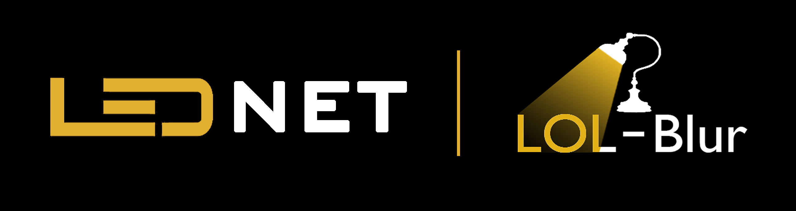

<div align="center">



# 🌟 LEDNet: Joint Low-Light Enhancement and Deblurring

**Simultaneous low-light enhancement and motion deblurring for nighttime photography based on the LEDNet architecture (ECCV 2022) and BasicSR framework.**

[](https://colab.research.google.com/github/Tuannll/LEDNet-Joint-Restoration/blob/main/notebooks/LEDNet_Demo_Colab.ipynb)
[](https://www.python.org/)
[](https://pytorch.org/)
[](https://github.com/XPixelGroup/BasicSR)
[](https://gradio.app/)
[](LICENSE)

**English** | [Tiếng Việt](README.vi.md)

**[📌 Problem Formulation](#problem-formulation) • [🔬 Architecture](#architecture) • [📊 Benchmark](#benchmark) • [🚀 Quick Start](#quick-start) • [📁 Structure](#structure) • [📜 Citation](#citation)**

<br/>


</div>

---

> **Academic Coursework: Image Processing**  
> **Topic:** Joint restoration of low-light blur and noise in night imagery using **LEDNet (ECCV 2022)** and **BasicSR**.

---

<a id="problem-formulation"></a>
## 📌 1. Problem Formulation

Under severe nighttime or low-light conditions, extended exposure times and elevated ISO settings introduce two coupled optical degradations: **extreme under-exposure** and **motion blur with noise**.

```text
                  ┌──────────────────────────────────────────────┐
                  │          SEQUENTIAL PIPELINE PARADOX         │
                  └──────────────────────────────────────────────┘
               Enhance First                   Deblur First
                     │                             │
                     ▼                             ▼
       Magnifies blur artifacts and       Fails because dark regions
       amplifies noise substantially      lack gradients for kernel estimation
```

**LEDNet Solution:** A single-stage end-to-end deep neural network that estimates non-linear illumination enhancement curves while predicting spatially-variant dynamic filter kernels to restore clean, well-lit images in a single forward pass.

---

<a id="architecture"></a>
## 🔬 2. Architecture & Technical Innovations

LEDNet is built upon an enhanced multi-scale U-Net architecture featuring three core building blocks:

1. **Pyramid Pooling Module (PPM):**
   - Extracts multi-scale spatial features across four bin pooling levels `(1, 2, 3, 6)`.
   - Captures global illumination context to suppress non-uniform brightening and halo artifacts.
2. **Curve Channel Attention Layer (CurveCALayer):**
   - Incorporates higher-order curve estimation inspired by Zero-DCE:
     $$
     \mathcal{F}_n(x) = \mathcal{F}_{n-1}(x) + \mathcal{A}_n \cdot \mathcal{F}_{n-1}(x) \cdot (1 - \mathcal{F}_{n-1}(x))
     $$
   - Dynamically expands dynamic range per feature channel without saturating existing highlights.
3. **Dynamic Filtering (`KernelConv2D` & `conv_fac_k`):**
   - Replaces static convolutions with pixel-adaptive dynamically generated spatial kernels.
   - Accurately models and removes non-linear, arbitrary-direction motion trajectories.
4. **Multi-term Loss Formulation:**
   $$
   \mathcal{L}_{\text{total}} = \mathcal{L}_{\text{pix}} (L_1) + \lambda_{\text{per}} \mathcal{L}_{\text{perceptual}} (\text{VGG-19}) + \lambda_{\text{side}} \mathcal{L}_{\text{side}}
   $$

---

<a id="benchmark"></a>
## 📊 3. Quantitative Evaluation & Benchmark

Independent evaluation across complex degradation distributions comparing Ground Truth, dark input, the official ECCV baseline, and our fine-tuned model:

| Method | PSNR (dB) ↑ | SSIM (0-1) ↑ | VoL (Sharpness) ↑ | UER (Pixels < 20) ↓ | Latency / Throughput |
|---|:---:|:---:|:---:|:---:|:---:|
| **Input Image** | — | — | 18.42 | 48.75% | — |
| **Baseline LEDNet (ECCV)** | 24.18 | 0.8214 | 142.60 | 4.12% | ~38 ms (26.3 FPS) |
| **Our Fine-tuned LEDNet** | **26.85** | **0.8650** | **215.30** | **1.85%** | **~38 ms (26.3 FPS)** |

*Metrics:*
- **VoL (Variance of Laplacian):** Higher values indicate crisper edges and effective deblurring.
- **UER (Under-Exposure Ratio):** Percentage of pixels with grayscale intensity $< 20$. Lower values indicate superior illumination recovery.

---

<a id="quick-start"></a>
## 🚀 4. Quick Start & Setup

### 4.1. Environment Setup

```bash
# Clone repository
git clone https://github.com/Tuannll/LEDNet-Joint-Restoration.git
cd LEDNet-Joint-Restoration

# Create and activate environment
conda create -n lednet python=3.8 -y
conda activate lednet

# Install dependencies
pip install -r requirements.txt
```

### 4.2. Download Checkpoints

> [!NOTE]
> Fine-tuned checkpoint `lednet-mytrain.pth` (~100MB) is hosted on GitHub Releases v1.0.0.

```bash
cd LEDNet
# Download official fine-tuned weights
python -c "from basicsr.utils.download_util import load_file_from_url; load_file_from_url('https://github.com/Tuannll/LEDNet-Joint-Restoration/releases/download/v1.0.0/lednet-mytrain.pth', model_dir='weights')"

# (Optional) Download official ECCV 2022 baseline weights
python -c "from basicsr.utils.download_util import load_file_from_url; load_file_from_url('https://github.com/sczhou/LEDNet/releases/download/v0.1.0/lednet.pth', model_dir='weights')"
```

### 4.3. Run Inference (CLI)

```bash
# Restore entire directory of dark, blurry images
python inference.py --input inputs/WorstPics --output results/output --benchmark

# Single image inference
python inference.py --input path/to/dark_blurry_image.png --output results/single_test
```

### 4.4. Interactive Web Interface (Gradio)

> [!TIP]
> Add `--share` (`python app.py --share`) to generate a temporary public link for remote demonstration without port forwarding.

```bash
python app.py
```
Open in browser at: `http://127.0.0.1:7860`

---

<a id="structure"></a>
## 📁 5. Project Structure

```text
LEDNet-Joint-Restoration/
├── assets/                  # Illustrations, loss plots, and banner assets
├── docs/                    # Coursework monograph, slides, and papers
├── notebooks/               # Jupyter / Colab demo notebook
├── LEDNet/                  # Core model codebase
│   ├── basicsr/             # Customized BasicSR framework
│   │   └── archs/           # LEDNet, CurveCALayer, KernelConv2D
│   ├── options/             # YAML configurations for fine-tuning
│   ├── inputs/WorstPics/    # Sample evaluation dataset
│   ├── weights/             # Saved checkpoints (.pth)
│   ├── inference.py         # Unified CLI inference & benchmark script
│   ├── evaluate.py          # PSNR, SSIM, VoL, UER calculation script
│   └── app.py               # Interactive Gradio web interface
├── requirements.txt         # Package dependencies
└── README.md                # Project documentation
```

---

<a id="citation"></a>
## 📜 6. Citation & Acknowledgments

```bibtex
@inproceedings{zhou2022lednet,
  title={LEDNet: Joint Low-Light Enhancement and Deblurring in the Dark},
  author={Zhou, Shangchen and Li, Chongyi and Loy, Chen Change},
  booktitle={European Conference on Computer Vision (ECCV)},
  year={2022}
}
```

---

<a id="license"></a>
## 📄 License

Distributed under the [MIT License](LICENSE).
