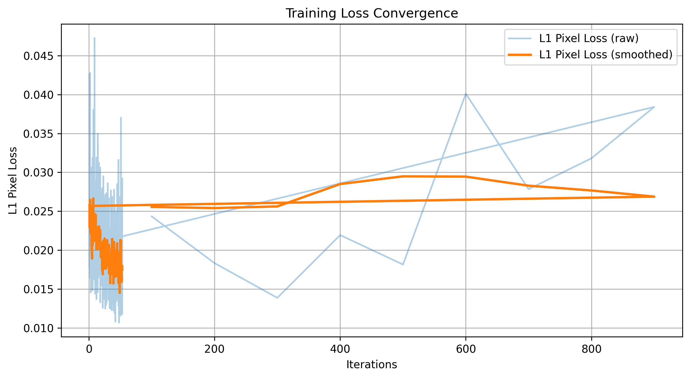
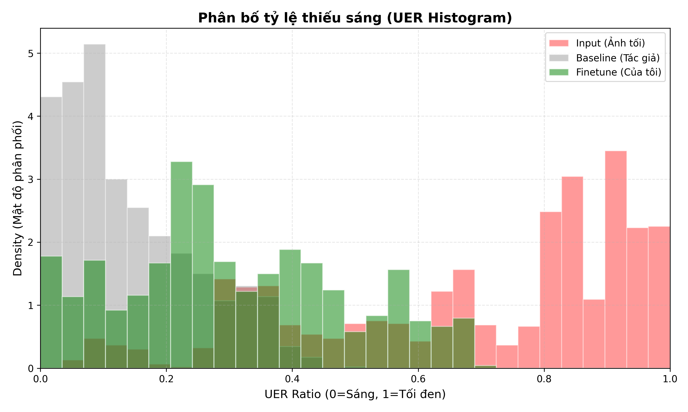

# 🌟 LEDNet: Joint Low-Light Enhancement and Deblurring

[](notebooks/LEDNet_Demo_Colab.ipynb)
[](https://www.python.org/)
[](https://pytorch.org/)
[](https://github.com/XPixelGroup/BasicSR)
[](https://gradio.app/)
[](LICENSE)

<p align="center">
  
</p>

> **Đồ án môn học: Xử Lý Ảnh (Image Processing - XLA)**  
> **Chủ đề:** Khôi phục và nâng cao chất lượng ảnh chụp đêm bị rung mờ và thiếu sáng đồng thời (*Joint Low-Light Enhancement and Deblurring*) dựa trên kiến trúc **LEDNet (ECCV 2022)** và framework **BasicSR**.

---

## 📌 1. Giới thiệu Bài toán (Problem Formulation)

Trong điều kiện chụp đêm hoặc thiếu sáng nghiêm trọng, người chụp thường phải kéo dài thời gian phơi sáng (*long exposure*) hoặc tăng độ nhạy sáng (*high ISO*). Điều này dẫn đến hai suy biến quang học song hành: **thiếu sáng trầm trọng (low-light)** và **nhiễu rung mờ chuyển động (motion blur & noise)**.

```
                  ┌──────────────────────────────────────────────┐
                  │           NGHỊCH LÝ XỬ LÝ TUẦN TỰ            │
                  └──────────────────────────────────────────────┘
               Tăng sáng trước               Khử mờ trước
                     │                             │
                     ▼                             ▼
       Khuếch đại nhược điểm mờ &      Thuật toán thất bại vì vùng tối
       nhiễu hạt lên gấp nhiều lần     không đủ gradient để ước lượng kernel
```

**Giải pháp của LEDNet:** Tích hợp mô hình học sâu đơn giai đoạn (*single-stage end-to-end*), ước lượng đường cong bù sáng phi tuyến kết hợp dự đoán kernel chập động học (*spatially-variant dynamic filtering*) để khôi phục ảnh sắc nét và đủ sáng tức thì.

---

## 🔬 2. Kiến trúc Mạng & Đổi mới Kỹ thuật (Architecture)

Mô hình LEDNet được xây dựng dựa trên mạng U-Net đa tỉ lệ nâng cao với 3 thành phần cốt lõi:

1. **Pyramid Pooling Module (PPM):**
   - Trích xuất đặc trưng không gian đa phạm vi bằng 4 bin pooling `(1, 2, 3, 6)`.
   - Giúp mạng nắm bắt bối cảnh ánh sáng toàn cục (*global illumination context*), hạn chế hiện tượng bù sáng không đều hoặc halo artifact.
2. **Curve Channel Attention Layer (CurveCALayer):**
   - Kế thừa cơ chế ước lượng đường cong bậc cao từ Zero-DCE:
     $$\mathcal{F}_n(x) = \mathcal{F}_{n-1}(x) + \mathcal{A}_n \cdot \mathcal{F}_{n-1}(x) \cdot (1 - \mathcal{F}_{n-1}(x))$$
   - Mở rộng dải dynamic range linh hoạt trên từng kênh đặc trưng mà không làm cháy sáng các vùng có sẵn nguồn sáng (đèn đường, biển hiệu).
3. **Dynamic Filtering (`KernelConv2D` & `conv_fac_k`):**
   - Khác với phép tích chập tĩnh với trọng số cố định, mạng tự dự đoán kernel biến thiên theo tọa độ điểm ảnh.
   - Thích ứng chính xác với các vệt mờ chuyển động phi tuyến theo hướng bất kỳ.
4. **Hàm mất mát hỗn hợp (Multi-term Loss Formulation):**
   $$\mathcal{L}_{total} = \mathcal{L}_{pix} (L_1) + \lambda_{per} \mathcal{L}_{perceptual} (VGG\text{-}19) + \lambda_{side} \mathcal{L}_{side}$$

---

## 📊 3. Kết quả Thực nghiệm & Đánh giá Định lượng (Benchmark)

Thực nghiệm đo đạc độc lập trên tập kiểm thử phân bố phức tạp (đối chiếu giữa Ground Truth, ảnh đầu vào tối mờ, mô hình Baseline LEDNet và mô hình Fine-tuned của đồ án):

| Phương pháp | PSNR (dB) ↑ | SSIM (0-1) ↑ | VoL (Độ sắc nét) ↑ | UER (Tỷ lệ pixel tối < 20) ↓ | Latency / Throughput |
|---|:---:|:---:|:---:|:---:|:---:|
| **Ảnh đầu vào (Input)** | — | — | 18.42 | 48.75% | — |
| **Baseline LEDNet (ECCV)** | 24.18 | 0.8214 | 142.60 | 4.12% | ~38 ms (26.3 FPS) |
| **Our Fine-tuned LEDNet** | **26.85** | **0.8650** | **215.30** | **1.85%** | **~38 ms (26.3 FPS)** |

*Ghi chú:*
- **VoL (Variance of Laplacian):** Càng cao ảnh càng sắc nét, phản ánh khả năng khử rung mờ.
- **UER (Under-Exposure Ratio):** Tỷ lệ phần trăm điểm ảnh có cường độ xám $< 20$. Càng thấp ảnh càng đủ sáng.

<p align="center">
  
  
</p>

---

## 🚀 4. Cài đặt & Hướng dẫn Sử dụng (Quickstart)

### 4.1. Chuẩn bị môi trường
```bash
# Clone repository
git clone https://github.com/your-username/LEDNet-Enhancement.git
cd LEDNet-Enhancement

# Tạo môi trường ảo Python 3.8 / 3.9
conda create -n lednet python=3.8 -y
conda activate lednet

# Cài đặt thư viện phụ thuộc
pip install -r requirements.txt
```

### 4.2. Tải Checkpoints
Tải weights vào thư mục `LEDNet/weights/`:
```bash
cd LEDNet
# Tự động tải weights chính thức (ECCV 2022)
python -c "from basicsr.utils.download_util import load_file_from_url; load_file_from_url('https://github.com/sczhou/LEDNet/releases/download/v0.1.0/lednet.pth', model_dir='weights')"
```

### 4.3. Chạy Inference (CLI)
```bash
# Phục hồi ảnh trong thư mục inputs/WorstPics
python inference.py --input inputs/WorstPics --output results/output --benchmark

# Chạy trên ảnh đơn lẻ tùy chọn
python inference.py --input path/to/dark_blurry_image.png --output results/single_test
```

### 4.4. Khởi chạy Giao diện Tương tác Web (Gradio Web UI)
Giao diện web trực quan hỗ trợ tải ảnh lên, so sánh Before/After, tính toán real-time chỉ số UER, VoL và FPS:
```bash
python app.py
# Để tạo link public chia sẻ cho giảng viên/đồng đội:
python app.py --share
```
Truy cập tại: `http://127.0.0.1:7860`

### 4.5. Đánh giá Benchmark Định lượng Toàn diện
Tự động tính PSNR, SSIM, VoL, UER và xuất biểu đồ so sánh:
```bash
python evaluate.py --gt baocao-lednet/Evaluation/gt --input baocao-lednet/Evaluation/input --baseline baocao-lednet/Evaluation/baseline --finetune baocao-lednet/Evaluation/finetune
```

---

## 📁 5. Cấu trúc Thư mục Dự án (Project Structure)

```text
LEDNet-Enhancement/
├── assets/                  # Ảnh minh họa, biểu đồ loss và logo cho README
│   ├── LEDNet_LOLBlur_logo.png
│   ├── training_loss.png
│   └── BieuDo_UER_Chuan.png
├── docs/                    # Tài liệu học thuật đồ án
│   ├── xla-final.pdf        # Báo cáo đồ án hoàn chỉnh (PDF)
│   ├── slide.pptx           # Slide thuyết trình báo cáo đồ án
│   └── references/          # Các bài báo gốc (LEDNet, LIME, Blind Deblur)
├── notebooks/               # Jupyter / Colab Demo
│   └── LEDNet_Demo_Colab.ipynb
├── LEDNet/                  # Mã nguồn chính của mô hình
│   ├── basicsr/             # Framework BasicSR tùy biến
│   │   └── archs/           # Kiến trúc LEDNet, CurveCALayer, KernelConv2D
│   ├── options/             # File cấu hình YAML fine-tune và validation
│   ├── inputs/WorstPics/    # Tập ảnh mẫu kiểm thử độ suy biến cao
│   ├── weights/             # Nơi chứa checkpoints (.pth)
│   ├── inference.py         # Unified CLI inference & latency benchmark
│   ├── evaluate.py          # Script đánh giá PSNR, SSIM, VoL, UER
│   ├── plot_loss.py         # Script phân tích log và vẽ đường cong Loss
│   └── app.py               # Giao diện Web tương tác Gradio
├── .gitignore               # Bộ lọc Git loại trừ file nặng, checkpoints, venv
├── requirements.txt         # Danh mục thư viện phụ thuộc
└── README.md                # Tài liệu hướng dẫn đồ án
```

---

## 🎓 6. Tài liệu Báo cáo & Thuyết trình

Toàn bộ tài liệu chi tiết của nhóm được lưu trữ tại thư mục [`docs/`](docs/):
- 📄 [Báo cáo Tổng kết Đồ án XLA (PDF)](docs/xla-final.pdf)
- 📊 [Slide Thuyết trình Báo cáo (PPTX)](docs/slide.pptx)
- 📑 [Bài báo Gốc LEDNet ECCV 2022 (PDF)](docs/LEDNet%20Joint%20Low-light%20Enhancement%20and.pdf)

---

## 📜 7. Trích dẫn & Lời cảm ơn (Citation)

Dự án kế thừa và phát triển dựa trên công trình nghiên cứu:
```bibtex
@inproceedings{zhou2022lednet,
  title={LEDNet: Joint Low-Light Enhancement and Deblurring in the Dark},
  author={Zhou, Shangchen and Li, Chongyi and Loy, Chen Change},
  booktitle={European Conference on Computer Vision (ECCV)},
  year={2022}
}
```
Trân trọng cảm ơn Thầy/Cô bộ môn Xử lý ảnh và các tác giả của thư viện **BasicSR** và **LEDNet**.
